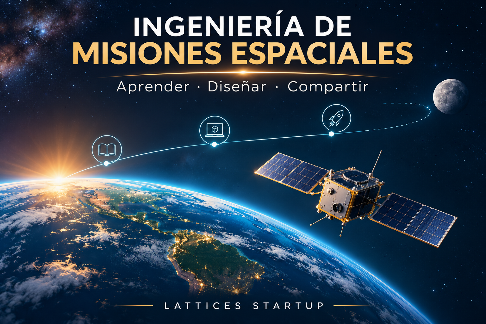

# 🚀 Ingeniería de misiones espaciales · Biblioteca de estudio

*Ilustración conceptual generada con IA para esta biblioteca independiente.*

**Estudia diseño de misiones espaciales paso a paso y aplica lo aprendido en proyectos con ayuda de un asistente.** Esta biblioteca educativa independiente desarrolla apuntes originales en español a partir de *Space Mission Analysis and Design* (SMAD), editado por James R. Wertz y Wiley J. Larson, y de fuentes públicas complementarias.

[📖 Comenzar la lección 1](lecciones/01-que-es-una-mision-espacial.md) · [👩‍🚀 Autores y obras](autores/README.md) · [📚 Acceso al libro](biblioteca/README.md) · [🛠️ Skills: diseño](skills/disenar-misiones-espaciales/README.md) y [revisión de software](skills/revisar-software-mision/README.md)

> **Estado:** biblioteca en construcción. Ya existe un apunte original del capítulo 1 de SMAD, tercera edición. Los capítulos restantes y el libro completo todavía no han sido estudiados; las lecciones introductorias se basan en fuentes públicas de NASA. La autorización para distribuir el PDF no ha sido verificada.

## 🧭 Rutas de aprendizaje

| Ruta | Contenido | Estado |
|---|---|---|
| 🌱 Fundamentos | Pregunta, objetivos, sistema, entorno y misión | [Lección 1 disponible](lecciones/01-que-es-una-mision-espacial.md) |
| 📐 Requisitos de software | Necesidades, pruebas y evidencia | [Lección 2 disponible](lecciones/02-requisitos-software.md) |
| 🛰️ Subsistemas | Carga útil, potencia, comunicaciones, control y plataforma | Planificado |
| 🔬 Verificación | Evidencia, incertidumbre y revisión | Planificado |
| 📚 Estudiar SMAD | Apuntes originales por capítulo | [Capítulo 1](lecciones/smad-capitulo-01-apunte.md) disponible; los demás están pendientes |
| 🎧 Escucha | Resumen introductorio y lectura por voz | [MP3 de la lección 1](audio/01-resumen.mp3); no es un audiolibro del libro |

Las rutas temáticas son una propuesta pedagógica independiente, no una reproducción del índice del libro. Cada apunte identifica las páginas consultadas. Este proyecto no es un curso oficial de NASA ni una publicación de los autores.

## 🤖 Del estudio a un asistente para proyectos

Una **skill** aporta instrucciones y fuentes a un asistente compatible; no entrena el modelo de forma permanente. Comienza con el [apunte del capítulo 1](lecciones/smad-capitulo-01-apunte.md), identifica objetivos, alternativas y evidencias, y después aplica las skills a un caso real o ficticio. Cada capítulo se incorporará después de su estudio.

> Ejemplo: «Revisa este repositorio de una misión educativa. Relaciona necesidades, requisitos, código y pruebas; compara alternativas, cita la evidencia y señala lo que no está verificado».

Las skills apoyan el razonamiento y la revisión humana; no certifican sistemas ni deciden el lanzamiento. La versión de revisión es un prototipo sin evaluación conductual independiente.

## 🛠️ Aplicar: skill de análisis de misión

Una skill es una carpeta de instrucciones para un asistente. La [skill de diseño de misiones espaciales](skills/disenar-misiones-espaciales/README.md) ayuda a formular un concepto educativo y a identificar supuestos, interfaces, riesgos y evidencias faltantes.

Ejemplo de solicitud:

> Usa la skill para ayudarme a describir una misión educativa ficticia de observación terrestre. Explica los requisitos, alternativas, incertidumbres y qué faltaría validar.

La skill es una primera versión sin validación práctica independiente. No certifica seguridad, cumplimiento, vuelo o viabilidad de una misión.

### 🔍 Skill de revisión de software

La [skill para revisar software de misión](skills/revisar-software-mision/README.md) ayuda a relacionar requisitos, código, pruebas y evidencia, e identificar decisiones pendientes. Es un prototipo educativo sin evaluación conductual independiente; requiere revisión humana y no certifica seguridad ni aptitud para vuelo.

## 📚 Libro y recursos

- [Ficha de la tercera edición en Springer](https://link.springer.com/book/9780792359012) y [búsqueda en bibliotecas](https://search.worldcat.org/title/951329431).
- [Guía oficial NASA Systems Engineering Handbook](https://www.nasa.gov/reference/systems-engineering-handbook/) y su [PDF NASA](https://www.nasa.gov/wp-content/uploads/2018/09/nasa_systems_engineering_handbook_0.pdf).
- [Biografías y obras relacionadas](autores/README.md).
- [Cómo estudiar y escuchar](COMO-ESTUDIAR.md).

SMAD es una obra con derechos de autor. Este repositorio no incluye una copia del libro ni afirma que sea de libre redistribución. Cada fuente mantiene sus condiciones y cualquier posible coste de acceso lo establece su proveedor.

## 🤝 Ciencia abierta responsable

Los apuntes originales, diagramas originales y documentación se ofrecen bajo [CC BY 4.0](LICENSE.md). Las publicaciones externas mantienen sus derechos; dar acceso público a un archivo no demuestra que se pueda redistribuir.

[Fuentes y verificación](FUENTES.md) · [Uso y derechos en Chile](biblioteca/derechos-uso-chile.md) · [Contribuir](CONTRIBUTING.md)

Desarrollado por **Lattices Startup** · Recurso independiente para aprender y compartir conocimiento.
