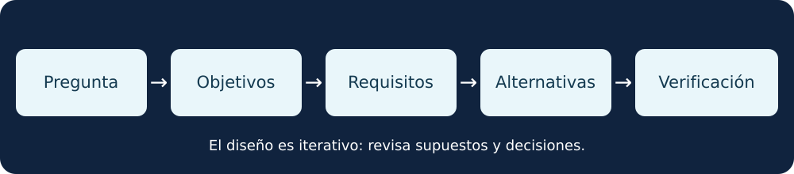

# Lección 1 · De una pregunta a una misión espacial

[🏠 Inicio](../README.md) · [📚 Fuentes](../FUENTES.md) · [🛠️ Skill](../skills/disenar-misiones-espaciales/SKILL.md)

**Origen:** lección introductoria original, basada en la guía pública NASA de ingeniería de sistemas. No corresponde a un capítulo verificado de SMAD.

## En dos minutos

Una misión espacial empieza por una necesidad o pregunta. Un equipo traduce esa necesidad en objetivos y requisitos, explora opciones y determina cómo comprobar si una solución podría cumplirlos.

La nave no trabaja sola: la misión incluye instrumentos, segmento terrestre, comunicaciones, personas, operaciones y el entorno donde funciona.

**Equivalente textual:** pregunta → objetivos → requisitos → alternativas → verificación. El proceso es iterativo: los resultados pueden obligar a revisar decisiones anteriores.

## 1. Pregunta, objetivo y requisito

Una **pregunta** expresa lo que se quiere conocer. Un **objetivo** describe el resultado buscado. Un **requisito** expresa una condición verificable que una solución debe cumplir.

Ejemplo inventado: un grupo desea aprender sobre cobertura de imágenes de un lago ficticio. La pregunta es cuándo podrían obtenerse imágenes. Un objetivo sería estudiar la cobertura. Un requisito educativo podría pedir que una simulación registre fecha, ubicación supuesta y criterios de cobertura.

El ejemplo no usa observaciones reales ni demuestra que un satélite pueda operar. Antes de convertir una idea en requisito de vuelo faltan valores justificados, unidades, condiciones, responsabilidades y criterios de aceptación.

## 2. Sistema e interfaces

Un sistema integra elementos que colaboran para una finalidad. En una misión, una carga útil puede necesitar energía, orientación, tiempo de operación y una forma de entregar datos. Una **interfaz** describe el intercambio entre elementos: señales, energía, datos, conexiones o responsabilidades.

Preguntas iniciales:

- ¿Quién utilizará el resultado y para qué?
- ¿Qué información produce la carga útil?
- ¿Cómo llega al segmento terrestre?
- ¿Qué condiciones o límites podrían impedir la operación?
- ¿Quién comprueba que la necesidad quedó satisfecha?

## 3. Alternativas y compromisos

Un equipo suele comparar opciones. Una misión simulada, datos existentes y una plataforma espacial propuesta pueden responder preguntas diferentes. No hay una arquitectura universalmente mejor.

Al comparar, registra criterios, supuestos y datos faltantes. Por ejemplo, aumentar la frecuencia de transmisión podría cambiar necesidades de energía y comunicaciones. Es una relación conceptual; no se ha calculado un balance para una misión real.

## 4. Verificar y validar

**Verificar:** comprobar si un producto cumple los requisitos establecidos. **Validar:** evaluar si el producto satisface la necesidad prevista en el contexto adecuado. Una prueba debe indicar qué se mide, con qué método y qué resultado se consideraría aceptable.

Una tabla bonita o una simulación sin contrastar no demuestra capacidad real. Conserva datos de entrada, versión, método y resultados para que otra persona pueda revisar el análisis.

## 🧪 Práctica: ficha de misión ficticia

Completa con palabras propias:

1. Necesidad o pregunta:
2. Persona o grupo que usaría el resultado:
3. Objetivo observable:
4. Tres elementos del sistema y sus interfaces:
5. Un requisito verificable, con unidad y condición si corresponde:
6. Una alternativa y una incertidumbre:
7. Una forma de comprobar el requisito:

**Criterio:** otra persona puede distinguir una necesidad de una solución y explicar qué evidencia faltaría. No uses datos privados ni atribuyas valores reales inventados a una misión.

## Comprueba lo aprendido

¿Una carga útil es toda la misión?

No. La misión también incluye otros elementos, como soporte, comunicaciones, operaciones y usuarios del resultado.

¿Un requisito sin unidades ni forma de comprobarlo está listo?

No necesariamente. Para que sea verificable necesita una condición clara y una forma apropiada de evaluación.

¿La lección reproduce el capítulo 1 de SMAD?

No. Es una introducción original basada en fuentes NASA; el índice y la edición de SMAD deben confirmarse con una copia autorizada.

## 🎧 Guion para leer en voz alta

Una misión espacial comienza con una necesidad. El equipo transforma esa necesidad en objetivos y requisitos que se puedan comprobar. Después compara alternativas y analiza cómo se relacionan sus elementos. La carga útil, la energía, las comunicaciones y las operaciones forman parte de un sistema. Cada decisión necesita supuestos claros y evidencia. Una simulación educativa ayuda a aprender, pero no valida una misión real.

🎧 [Escuchar o descargar el resumen en MP3](../audio/01-resumen.mp3) · Voz sintética en español, duración aproximada 26 segundos. Es un resumen original de esta lección, no un audiolibro de SMAD.

## Fuentes y límites

- NASA, [Fundamentals of Systems Engineering](https://www.nasa.gov/reference/2-0-fundamentals-of-systems-engineering/).
- NASA, [Systems Engineering Handbook](https://www.nasa.gov/reference/systems-engineering-handbook/).
- Referencia bibliográfica: [SMAD, tercera edición](https://link.springer.com/book/9780792359012). No se accedió al texto completo del libro para redactar esta lección.

Consulta las normas, requisitos y documentación pertinentes antes de aplicar métodos a una misión real.
